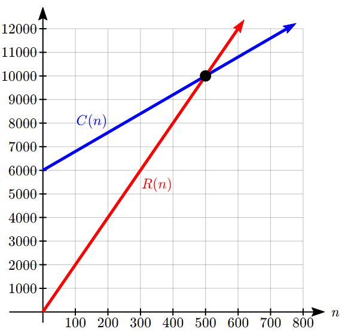
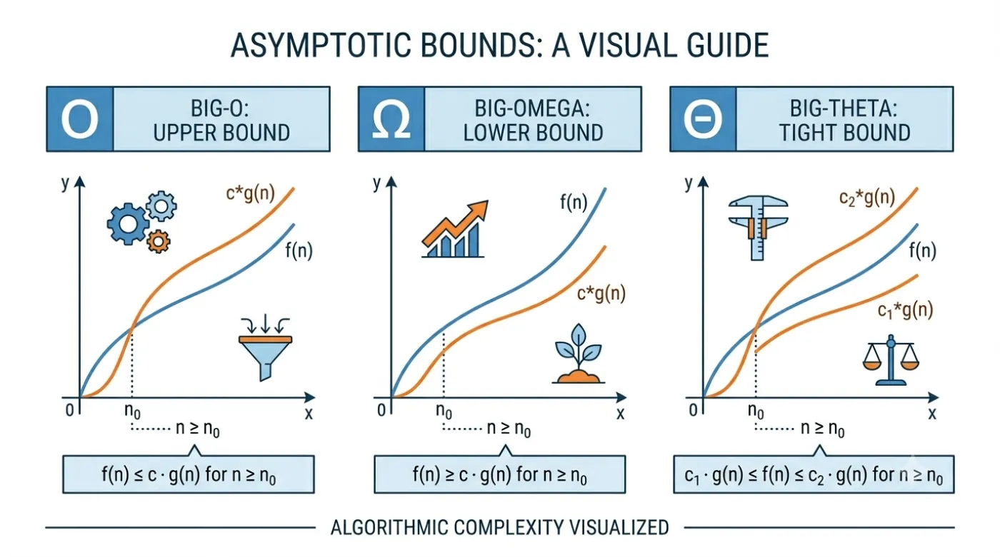
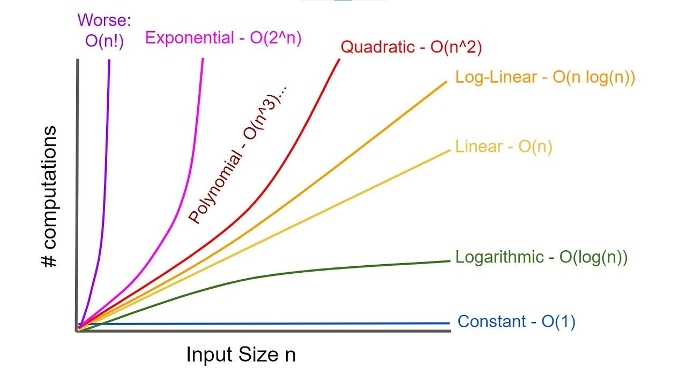

# Introduction

**Data Structures and Algorithms** consists of two main concepts:

1. **Data Structure**
2. **Algorithm**

## Data Structures

**Data Structures** are formats for organising, processing and storing data.

In computer science, data structures are formally classified based on how data is organized in memory, the relationships between data elements, and how they can be manipulated.

They are:

1. Primitive Data Structures
2. Non-Primitive Data Structures

### 1. Primitive Data Structures

**Primitive data structures** are the foundational, basic data types supported directly by a programming language or machine architecture. They can hold a single value.

**Characteristics**: They are building blocks, language-dependent, and typically occupy a fixed amount of memory.

**Examples**:

1. **Integer**: Whole numbers (e.g., 42).
1. **Floating-Point / Double**: Numbers with decimal points (e.g., 3.14159).
1. **Character**: Single letters or symbols (e.g., 'A').
1. **Boolean**: True or false values.
1. **Pointer / Reference**: Variables that store memory addresses of other variables.

### 2. Non-Primitive Data Structures

Non-primitive data structures are more sophisticated, user-defined or derived structures built using primitive data structures. They can store multiple values and collections of data.

These are broadly divided into 3 categories:

1. Linear Data structures
2. Non-linear Data structures
3. Hash-Based Data structures

#### Linear Data Structures

In a linear data structure, data elements are arranged sequentially or linearly. Each element is connected to its previous and next element, meaning the data can be traversed in a single run.

- **Array**: A fixed-size, homogeneous collection of elements stored in contiguous memory locations. Elements are accessed directly via an index.
- **Vector**: A dynamically-sized, homogeneous collection of elements stored in contiguous memory locations. Elements are accessed directly via an index.
- **Linked List**: A dynamic collection of nodes where each node contains data and a reference (pointer) to the next node.
    - **Variants**:
        - Singly Linked List
        - Doubly Linked List
        - Circular Linked List.

- **Stack**: A LIFO (Last In, First Out) structure where elements are added and removed from only one end (the top).
- **Queue**: A FIFO (First In, First Out) structure where elements are inserted at the back (rear) and removed from the front.
    - **Variants**:
        - Linear Queue,
        - Circular Queue,
        - Deque (Double-Ended Queue),
        - Priority Queue.

#### Non-Linear Data Structures

In a non-linear data structure, elements are not arranged in a sequential order. Instead, elements form a hierarchical or interconnected network where a single data element can connect to multiple other elements.

- **Tree**: A hierarchical structure consisting of a root node with branching child nodes. There are no cycles.
    - **Variants**: Binary Tree, Binary Search Tree (BST), AVL Tree, Red-Black Tree, B-Tree, Trie (Prefix Tree).
- **Graph**: A network of nodes (Vertices) connected by links (Edges). Graphs can model complex relationships, maps, and networks.
    - **Variants**: Directed vs. Undirected, Weighted vs. Unweighted, Cyclic vs. Acyclic.

#### Hash-Based Data Structures

Hash-based structures leverage mathematical algorithms (hash functions) to organize and locate data instantly, bypassing sequential searches.

- **Hash Table / Hash Map**: Stores data in key-value pairs. A hash function computes an index (bucket) where the value is stored, enabling average O(1) lookups.
- **Hash Set**: Similar to a hash table, but it stores unique keys only (no associated values), used for fast membership testing.

## Algorithm

An **algorithm** is a step-by-step set of instructions or rules designed to solve a specific problem or perform a particular task.

For example if you have to add two numbers, the algorithm is like:

1. Take two numbers in input
2. Add them
3. Print to the screen

## Why Learn Data Structure and Algorithm

1. **It helps in cracking tech interviews**: Top tech companies and software jobs rely heavily on DSA questions to test your problem-solving skills during interviews.
2. **It teaches you problem solving skills**. It helps us to solve complex problem efficiently by using right data structure and most optimal algorithm

# Basics

## 1. Basics of Algorithm

| Problems                                                                            | Answers                                                                                      | Video solution |
| ----------------------------------------------------------------------------------- | -------------------------------------------------------------------------------------------- | -------------- |
| [Reverse a Number](https://leetcode.com/problems/reverse-integer)                   | [Article](./Solutions/1.%20Basics/1.%20Basics%20of%20Algorithm/1.%20Reverse%20a%20Number.md) | [Video]        |
| [Check Palindrome](https://leetcode.com/problems/palindrome-number)                 | [Article](./Solutions/1.%20Basics/1.%20Basics%20of%20Algorithm/2.%20Check%20Palindrome.md)   | [Video]        |
| [Armstrong Numbers](https://www.geeksforgeeks.org/problems/armstrong-numbers2727/1) | [Article](./Solutions/1.%20Basics/1.%20Basics%20of%20Algorithm/3.%20Armstrong%20Numbers.md)  | [Video]        |

## 2. Basics of recursion

| Problems                                                                                                          | Answers                                                                                   | Video solution |
| ----------------------------------------------------------------------------------------------------------------- | ----------------------------------------------------------------------------------------- | -------------- |
| [Power of Four](https://leetcode.com/problems/power-of-four/description/?envType=problem-list-v2&envId=recursion) | [Article](./Solutions/1.%20Basics/2.%20Basics%20of%20recursion/1.%20Power%20of%20Four.md) | [Video]        |

## 3. Analysing Performance of an Algorithm

Okay so now that we know about algorithm suppose there is a problem: `check palindrome` and we know that we can have multiple algorithm to solve a problem. And i come up with two solutions: `Algorithm 1`, and `Algorithm 2`.

```cpp

// Algorithm 1
bool isPalindrome(int x) {
        std::string o = std::to_string(x);
        std::string str = std::to_string(x);
        std::reverse(str.begin(), str.end());
        return str == o;
    }

// Algorithm 2
bool isPalindrome(int x) {
        if(x < 0 || (x % 10 == 0 && x != 0)) return false;
        int rev = 0;
        while(x > rev) {
            rev = rev * 10 + x % 10;
            x /= 10;
        }
        return x == rev || x == rev / 10;
}
```

So out of these two algorithms which algorithm should we choose?

**Answer** is obvious chose the one which perform better.

**So what are the ways to analyse which algorithm is better and when do we say that one algorithm is better than other?** Well, when analysing algorithm we mostly care about just two things:

1. How much time an algorithm takes to run
2. How much memory(space) it takes

A very simple way to do this is by any command-line tools like `time` command in linux or for a platform independent way, we can write a very simple python script that would do that for us.

```python
import subprocess
import time
import psutil

# Command to run your compiled C++ program
command = ["./my_program"]

# Start the process and the timer
start_time = time.time()
process = subprocess.Popen(command)

peak_memory = 0

# Poll the process while it's running to capture peak memory (RSS)
while process.poll() is None:
    try:
        p = psutil.Process(process.pid)
        mem_info = p.memory_info().rss  # Resident Set Size in bytes
        if mem_info > peak_memory:
            peak_memory = mem_info
    except (psutil.NoSuchProcess, psutil.AccessDenied):
        break
    time.sleep(0.001)  # Poll every 1ms

end_time = time.time()
elapsed_time = end_time - start_time

print(f"Execution Time: {elapsed_time:.4f} seconds")
print(f"Peak Memory (RSS): {peak_memory / (1024 * 1024):.2f} MB")
```

Using this script, we can figure out how much time an algorithm takes to run and how much memory it takes. But there is a big flaw. Suppose you are working in team and you come up with an algorithm that takes 1ms to run and then your co-worker comes up with an algorithm that takes 2ms then does that mean your algorithm is better. Answer isn't always yes. It's because how much time an algorithm takes to run doesn't just depend on how efficient an algorithm is but also on many other factors.

It is fundamentally flawed for comparing algorithms universally due to four key reasons:

1. **Hardware Bias**: The same code runs significantly faster on a high-end machine with a modern processor than on an older laptop or mobile device.
1. **Environment & Background Noise**: Operating system scheduling, background processes, compiler/interpreter optimizations, and memory management (like garbage collection) introduce unpredictable variations in time.
1. **Language Dependency**: Code written in C or C++ will almost always execute faster than the exact same algorithm written in Python or JavaScript.
1. **Input Limitations**: Testing requires running the code with specific datasets. An algorithm might perform exceptionally well on small inputs (e.g., $N=100$) but completely collapse on massive datasets (e.g., $N=10,000,000$), which might crash your system during a test run.

So now we know that just measuring time and memory taken by an algorithm isn't a good way of measuring its performance and we need a better way that shouldn't get affected by all those extra noise. And that's why we use **Complexity Analysis**.

### Complexity analysis

So, **Complexity analysis** is a technique used to evaluate an algorithm's efficiency independently of any machine or environment.

There are mainly two types of complexity analysis:

1. **Time Complexity Analysis**: Measures how the amount of operations/running time increases as the input size (n) grows. We count the number of basic operations (like comparisons or assignments), not actual seconds.
2. **Space Complexity Analysis**: Measures how much extra memory (auxiliary space) the algorithm requires in RAM relative to the input size n.

Okay now we know we use complexity analysis instead of measuring time and memory but **how do we actually do it mathematically?**

So, let's look at our previous example:

```cpp

// Algorithm 1
bool isPalindrome(int x) {
        std::string o = std::to_string(x);  // it takes a constant time -- c
        std::string str = std::to_string(x); // it takes a constant time -- k
        std::reverse(str.begin(), str.end()); // it takes some time that is depend on n -- pn
        return str == o; // it takes constant time m
    }

// Total time: c + k + pn + m

// Algorithm 2
bool isPalindrome(int x) {
        if(x < 0 || (x % 10 == 0 && x != 0)) return false;
        int rev = 0;
        while(x > rev) { // runs as number of digits -- n
            rev = rev * 10 + x % 10; // takes c time
            x /= 10; // takes k time
        }
        return x == rev || x == rev / 10; // takes m time
}

// total time = n*(c + k) + m
```

Okay so now we have got the time compleixty of function in terms of n, and to decide which algorithm is better we can see which takes less time, i.e. we'll just have to compare these mathematical functions. We can easily do it by plotting graph of these mathematical functions.

Let's assume $C(n)$ represent `algorithm 1` and $R(n)$ represent `algorithm 2`. So we can clearly see that when value of $n \gt 500$, `algorithm 2` teakes less time than `algorithm 1`. And in most situation size of input($n$) is very large so `algorithm 2` is better.

Nice, now we can evaluate algorithms indpendent of any machine or environment. But, as we mainly care about algorithms that takes large inputs so is there any better way to compare these algorithms, where we can still use this concept of calculating time in steps but simply time function and compare those time functions easily. So for this, we'll introduce a new concept called "Asymptotic Analysis".

To understand essence **Asymptotic Analysis**, consider this equation:
$$ y = x^{3} + x + 2 $$

if we consider the values of $y$, at \
$x=0, y=2$,\
$x=2, y=12$,\
$x=10, y=1012$,\
$x=100, y=1000102$\
$x=10000, y=10000000010002$\
as you can see as as value of input ($x$) increases the the $x^3$ part of the function becomes dominating. So as $x \to \infty$, we can assume that $y \approx x^{3}$. This is the core idea of **Asymptotic Analysis**.

### Asymptotic Analysis

**Asymptotic analysis** is the mathematical way of evaluating an algorithm's performance as the input size (n) approaches infinity ($n \to \infty$).

In **Asymptotic Analysis**, we have mainly 3 notations:

1. Big-O ($O$): used to measure worst-case time complexity or upper bound.
2. Big-Omega ($\Omega$): used to measure average-case time complexity or tight bound.
3. Big-Theta ($\Theta$): used to measure best-case time complexity or lower bound.

### Mathematics of Asymptotic Notations

#### Big $O$

**Big $O$** describes the maximum growth rate of an algorithm. It guarantees that the algorithm will never grow faster than a certain rate for large inputs.

**Mathematical definition**: A function is called Big $O(n)$ if there exists a function $g(n)$ such that: $0 \leq f(x) \leq c.g(n)$ for every $n \geq n_0$.

Here is the definition of other notations:


Okay so now that we know about mathematical definition let's apply it using one problem:

**Question**: _Prove that $2n  + 2$ can be consisered of complexity $O(n^2)$_.

**Answer**:
We know that $2n + 2 \leq n^2$ for every $n \geq 2$ so $2n  + 2$ can be consisered of complexity $O(n^2)$.

We just saw an example problem regarding finding Big $O$, even though our answer that _"$2n  + 2$ can be consisered of complexity $O(n^2)$"_ is correct but in real life we don't write it as $O(n^2)$ rather we consider it as $O(n)$. Okay but how's that?

Well **we have some rules that we have to follow when we want to find out Big $O$, those rules are**:

1. **Focus on the Worst-Case**: Always assume the input causes the maximum possible work (e.g., searching for an element that isn't in the list).
2. **Drop Constants**: Multiplicative constants don't change the growth curve at scale.
    - $3N \to O(N)$
    - $100N^3 \to O(N^3)$
3. **Drop Lower-Order Terms**: Keep only the fastest-growing term because it dominates as $N \to \infty$.
    - $N^2 + 5N + 3 \to O(N^2)$
4. **If any function takes only constant time then it is said to be $O(1)$**

Okay enough theory, let's now find out time complexity in Big $O$ of a real algorithm.

Consider this algorithm:

```cpp
int sum(int arr[], int size){ // runs N time, here N=size
    int result = 0; // takes constant time a
    for(int i = 0; i < size; ++i){
        result += arr[i]; // takes constant time b
    }
}
```

So we can see that this algorithm would have time complexity as $a + bN$ and in terms of big $O$, we can say its $O(N)$.

### Calculating Big $O$

#### Iterative functions

**Example 1**:

```cpp
int func(int n){
    int count = 0; // constant time a & constant space p
    for (int i = 0; i < n; ++i){ // runs n time & constant space by i -- q
        count += 1; // constant time b
    }
    return count; // constant time c
}
```

_Solution:_

**Time Complexity**:

$$
\begin{aligned}
time(n) &= a + bN + c \\
          &= (a+c)+bN \\
          & \approx O(N)

\end{aligned}
$$

**Space complexity**:

$$
\begin{aligned}
space(n) &= p+ q\\
&\approx O(1)
\end{aligned}
$$

**Example 2**:

```cpp
int func(int n){
    int count = 0; // constant time a & constant space p
    for (int i = 0; i < n; ++i){ // runs n time & constant space by i -- q
        for (int j = 0; j < n; ++j){ // runs n time & constant space by j -- r
            count += 1; // constant time b
        }
    }
    return count; // constant time c
}
```

_Solution:_

**Time complexity**:

$$
\begin{aligned}
time(n) &= a + bN + bN + ... + 2b + b + c \\
        &= (a+c)+b\sum_{n=1}^{N}N \\
        &= (a+c)+bN^2 \\
        & \approx O(N^2)
\end{aligned}
$$

**Space complexity**:

$$
\begin{aligned}
space(n) &= p+ q + r\\
&\approx O(1)
\end{aligned}
$$

**Example 3**:

```cpp
int func(int n){
    int count = 0; // constant time a & constant space p
    for (int i = 0; i < n; ++i){ // runs n time & constant space by i -- q
        for (int j = i; j < n; ++j){ // runs n, n-1, n-2, .... 1 times & constant space by j -- r
            count += 1; // constant time b
        }
    }
    return count; // constant time c
}
```

_Solution:_

**Time complexity**:

$$
\begin{aligned}
time(n) &= a + bN + b(N-1) + ... + 2b + b + c \\
        &= (a+c)+b\sum_{n=0}^{N-1}(N-n) \\
        &= (a+c)+bN^2 - \frac{b}{2}N(N-1)\\
        &= (a+c)+\frac{b}{2}N^2 - \frac{b}{2}N\\
        & \approx O(N^2)
\end{aligned}
$$

**Space complexity**:

$$
\begin{aligned}
space(n) &= p+ q + r\\
&\approx O(1)
\end{aligned}
$$

**Example 4**:

```cpp
int func(int n){
    int count = 0; // constant time a and constant space p
    while (n > 1){
        n = n / 2; // constant time b
        count += 1; // constant time c
    }
    return count; // constant time d
}
```

_Solution:_

**Time complexity**:

Let's look at the loop first. it runs till $n \leq 1$ as $n$ is integer. Let's now trace how many times the loop would run.

- In first loop it runs with $n=N$,
- second loop: $n = N/2$
- third loop: $n=N/2^2$
- $k^{th}$ loop: $n=N/2^k$

So after $k^{th}$ loop, $n=1$. it means:

$$
\begin{aligned}
\frac{N}{2^k} &= 1 \\
            N &= 2^k \\
            \log_2{N} &=k
\end{aligned}
$$

It means for $n=N$, loop runs $k=\log_2{N} \approx \log{N}$ times.

$$
\begin{aligned}
time(n) &= a + (b+c)\log{N} + d \\
        &= (a+d) + (b+c)\log{N} \\
        & \approx O(\log{N})
\end{aligned}
$$

**Space complexity**:

$$
\begin{aligned}
space(n) &= p\\
&\approx O(1)
\end{aligned}
$$

#### Recursive functions

**Example 1:**

```cpp
void func(int n){
    if (n > 0){
        std::cout <<"printing"; // constant time a
        func(n-1); // T(n-1)
    }
}
```

_Solution:_

**Time complexity**:

We know $T(0) = 0$

$$
\begin{aligned}

T(N) &= T(N-1) + a \\
     &= (T(N-2) + a) + a \\
     &= T(N-2) + 2a\\
     &= T(N-3) + 3a\\
     &= T(N-K) + Ka\\
\end{aligned}
$$

when $N=K$

$$
\begin{aligned}
T(n) &= T(N-K) + Ka\\
     &= T(0) + Na\\
     &= Na\\
     & \approx O(N)
\end{aligned}
$$

**Space complexity**:

For space complexity we see that function itself doesn't allocate any memory but we function calls are stored on stack and function would keep stacking until it hits the base condition at $n=0$.

So space complexity is $O(N)$

**Example 2:**

```cpp
void func(int n){
    if (n > 0){
        for (int i = 0; i < N; ++i){ // runs N time
            std::cout <<"printing"; // constant time a
        }
        func(n-1);
    }
}
```

_Solution:_

**Time complexity**:

We know $T(0) = 0$

$$
\begin{aligned}

T(N) &= T(N-1) + Na \\
     &= (T(N-2) + Na) + Na \\
     &= T(N-2) + 2Na\\
     &= T(N-3) + 3Na\\
     &= T(N-K) + KNa\\
\end{aligned}
$$

when $N=K$

$$
\begin{aligned}
T(n) &= T(N-K) + KNa\\
     &= T(0) + aN^2\\
     &= aN^2\\
     & \approx O(N^2)
\end{aligned}
$$

**Space complexity**:

For space complexity we see that function itself doesn't allocate any memory but we function calls are stored on stack and function would keep stacking until it hits the base condition at $n=0$.

So space complexity is $O(N)$

**Example 3:**

```cpp
void func(int n){
    if (n > 0){
        for (int i = 1; i < N; i = i*2){ // runs logN times
            std::cout <<"printing"; // constant time a
        }
        func(n-1);
    }
}
```

_Solution:_

**Time complexity**:

Let's first look at the loop. assume $n=N$, it start with $i=0$ and then in first look it run and makes $i=2$
So,

- In first round, $i=1$
- second round, $i=2$
- third round, $i=2^2$
- fourth round, $i=2^3$
- $k^th$ round, $i=2^{k-1}$

assuming after a certain value of $k$, $2^{k-1} > N$ so at max it would run till $k-1$ times.

$$
\begin{aligned}
N &< 2^{k-1} \\
\log{N} &< k-1 \\
k-1 &> \log(N)
\end{aligned}
$$

It means loop would run $log(N)$ times.

We know $T(0) = 0$

$$
\begin{aligned}

T(N) &= T(N-1) + \log{N}a \\
     &= (T(N-2) + Na) + \log{N}a \\
     &= T(N-2) + 2\log{N}a\\
     &= T(N-3) + 3\log{N}a\\
     &= T(N-K) + K\log{N}a\\
\end{aligned}
$$

when $N=K$

$$
\begin{aligned}
T(n) &= T(N-K) + K\log{N}a\\
     &= T(0) + aN\log{N}\\
     &= aN\log{N}\\
     & \approx O(N\log{N})
\end{aligned}
$$

**Space complexity**:

For space complexity we see that function itself doesn't allocate any memory but we function calls are stored on stack and function would keep stacking until it hits the base condition at $n=0$.

So space complexity is $O(N)$

**Example 4:**

```cpp
void func(int n){
    if (n > 0){
        std::cout <<"printing"; // constant time a
        func(n-1);
        func(n-1);
    }
}
```

_Solution:_

**Time complexity**:

We know $T(0) = 0$

$$
\begin{aligned}

T(N) &= 2T(N-1) + a \\
     &= 2(2T(N-2) + a) + a \\
     &= 2^2T(N-2) + a + 2a\\
     &= 2^3T(N-3) + a(1+2+2^2)\\
     &= 2^KT(N-K) + a(1+2+...+2^{K-1})\\
\end{aligned}
$$

when $N=K$

$$
\begin{aligned}
T(n) &= 2^KT(N-K) + a(1+2+...+2^{N-1})\\
     &= a(1+2+...+2^{N-1})\\
     &= a\frac{2^N -1}{2-1}\\
     &= a(2^N -1)\\
     &= a2^N -a\\
     & \approx O(2^N)
\end{aligned}
$$

**Space complexity**:

For space complexity we see that function itself doesn't allocate any memory but we function calls are stored on stack and function would keep stacking until it hits the base condition at $n=0$.

So space complexity is $O(N)$

#### Order of complexities

There are some common time complexities like $O(n)$, $O(log (n))$ or $O(1)$ that we often encounter in real life so knowing order of complexity would make it easy to compare algorithms.

Here is the graph of some common time complexities.


Through the above graph we can clearly see that time taken $O(N)$ is more than $O(1)$ and exact order is as follows:
$$O(1) < O(log(N)) < O(N) < O(Nlog(N)) < O(N^2) < O(2^N) < O(N!)$$

# Maths for DSA
